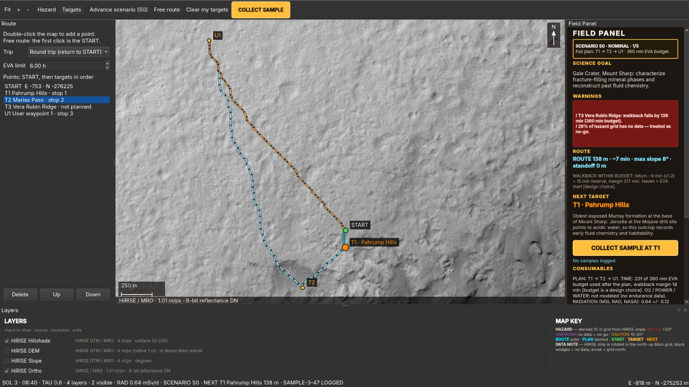
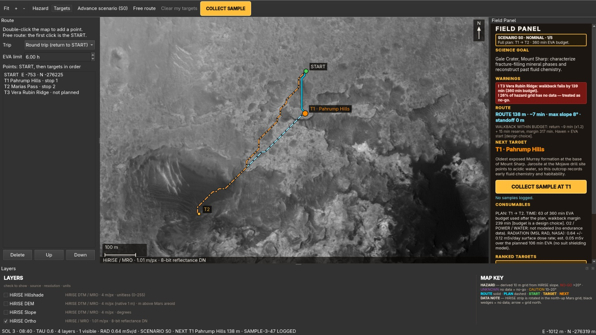
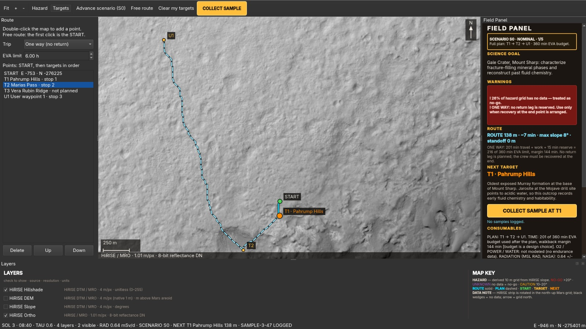

# Cetus

Offline field tool for a **Mars astronaut** on a surface EVA. Native Qt 6 / C++17.

- **Region:** Gale Crater, Mount Sharp foothills (Pahrump Hills / Garden City vein belt).
- **Science goal:** characterise boxwork / fracture-filling **sulfate and hydrated veins**
  to reconstruct past fluid chemistry and habitability.
- **What it does:** ranks science targets, draws a hazard-avoiding traverse, checks
  the **walkback** rule, shows the EVA time budget, replans when a scripted
  scenario event hits, and logs a geotagged field note at the target.

Scope is locked in [AGENTS.md](AGENTS.md). Milestones are in [PLAN.md](PLAN.md).
Development notes are in [docs/PROGRESS.md](docs/PROGRESS.md).

## UI





## Status

| Milestone | Feature | Status |
|---|---|---|
| M0 | Scaffold, window | done |
| M1 | HiRISE rasters, zoom/pan map | done |
| M2 | Layer legend (source, resolution, units) and toggles | done |
| M3 | Target ranking, hazard grid, route, side panel | done |
| M4 | Walkback rule, time budget, greedy multi-target plan | done |
| M5 | Scenario S0 to S4 with "Advance scenario" control | done |
| M6 | Sample logging: field note, geotag, DEM orientation | done |
| M7 | README, citations, demo script | docs written; rehearsal pending (no rehearsal checklist file in the repo yet) |
| M8 | Radiation (MSL RAD) as third data kind; user targets by map double-click; free route mode | done; built and run in the app |

## Honest limits

- **Measured data kinds:** optical (HiRISE ortho), topographic (HiRISE DTM) and
  radiation (MSL RAD dose rate, a single published value, not a map layer). Slope
  and hillshade are derived from the DTM. Radiation is a scalar: it is shown in the
  status bar and the consumables text with a dose estimate for the planned EVA
  (rate x EVA time; no suit shielding or solar-event model, no dose limit claimed).
- **User targets:** double-click the map to add a target (max 6). It is routed and
  walkback-checked like the scenario targets; an unreachable point is flagged.
  Its science value (1.0) and work time (15 min) are design choices.
- **Consumables:** O2, power and water are **not modeled** (no endurance data). The
  panel shows EVA time budget only.
- **Design choices, not NASA values:** 360 min EVA budget, 1.2x return factor,
  15 min reserve, storm budget 90 min, tau steps, comms offline 40 min,
  power-low event. All are marked `[tunable]` in code. The safe haven is the EVA
  start point (no real shelter coordinate exists in the data).
- **Scenario:** a tau rise cuts the time budget; it does not change the primary
  target (T1 stays best). S4 power-low is a scripted event, not a model.
- **Crew position is not simulated.** The plan always starts at the EVA start
  point with 0 min elapsed; nothing moves along the route.
- **Sample log persists across runs.** It is append-only, so the status bar can name
  an earlier note (for example `SAMPLE-3-47 LOGGED`) while the side panel still says
  "No samples logged." until a note is taken in the current session. For a clean
  demo start the app with `CETUS_SAMPLE_LOG=/tmp/demo.jsonl ./build/cetus`.
- **Two margins in the panel:** the ROUTE text reports the walkback margin for the
  next target alone; the consumables text reports the margin left after the whole
  plan. They differ when the plan has more than one stop.
- A sample record is a **field note**. No physical sample or composition
  measurement is claimed.

## NASA data used

Product IDs, URLs, processing commands and caveats: [docs/data-sources.md](docs/data-sources.md).

| Kind | Product | Source |
|---|---|---|
| Optical | `ESP_040770_1755_RED_C_01_ORTHO`, 1.01 m/px | NASA/JPL/Univ. of Arizona, MRO HiRISE |
| Topographic | `DTEEC_040770_1755_039280_1755_U01` stereo DTM | HiRISE / USGS Astrogeology |
| Radiation | MSL RAD surface dose equivalent rate 0.64 +/- 0.12 mSv/day | Hassler et al., Science 343, 1244797 (2014), doi:10.1126/science.1244797 |
| Derived | slope (deg), hillshade, 4 m/px | computed offline from the DTM |
| Targets, EVA start | Pahrump Hills, Marias Pass, Vera Rubin Ridge; Curiosity path | NASA Mars Trek |

Mars CRS only (Mars equirectangular, `A_AXIS_RADIUS = 3396.19 km`), never WGS84 or
Web Mercator. Missing raster values mean **unknown**, never safe.

## Build and run

Needs CMake 3.20+, a C++17 compiler, Qt 6 (Core, Gui, Widgets; Qt Test for the
tests) and GDAL (which brings PROJ). Preparing the rasters also needs the GDAL
command-line tools (`gdal_translate`, `gdaldem`, `gdaltransform`).

```bash
cmake -S . -B build -DCMAKE_BUILD_TYPE=Release
cmake --build build -j
ctest --test-dir build --output-on-failure
./build/cetus
```

The four prepared rasters are **not in git**. Build them first into
`assets/layers/` with the commands in [docs/data-sources.md](docs/data-sources.md)
section 3. Without them the data tests fail and the map is empty. The app needs no
network at run time.

Environment variables:

| Variable | Effect |
|---|---|
| `CETUS_ASSET_DIR` | override the assets folder |
| `CETUS_SAMPLE_LOG` | sample log path (default `<AppData>/samples.jsonl`, normally `~/.local/share/cetus/samples.jsonl` on Linux) |

## Using the app

- **Advance scenario:** steps S0 nominal, S1 dust rising, S2 dust storm (budget cut),
  S3 comms closed, S4 power low (science disabled); the last step restarts.
- **COLLECT SAMPLE:** appends `SAMPLE-<sol>-<n>` with coordinates, DEM up-vector,
  slope and a field note to the JSONL log.
- **Add a target:** double-click the map. The point is routed, walkback-checked and
  ranked as `U1`..`U6`; **Clear my targets** removes them.
- **Free route:** toolbar toggle. Ignores the scenario targets and start. The first
  double-click sets the START, later ones add targets; routes, walkback and radiation
  work the same, with the start as haven. **Clear my targets** resets start and
  targets. Switching it off restores scenario S0-S4 unchanged (Advance is disabled
  while it is on).
- **Route dock (left):** trip type, EVA limit and the point list.
  - *Trip:* **Round trip** counts the way back in the EVA limit; **One way** plans no
    return leg (a warning says recovery must be arranged). The way back is the
    **best path** from the last stop to the START (dashed amber on the map), not a
    retrace of the outward legs. Walking back is still x1.2 slower plus 15 min reserve.
  - *EVA limit:* 6 h by default, a planning assumption, editable (0.5 to 12 h). It
    caps the whole trip including the way back. Storm steps in the scenario cut it
    further.
  - *Points:* select a row and press **Delete** (or the key). Delete the START and
    the next point becomes the START; with no points left, set a new one. **Up/Down**
    reorder targets. In Free route the targets are visited in the listed order and the
    route stops at the first point that breaks the limit. In the scenario only your
    own `U` points can be deleted; the scenario points stay.
  - Warnings (side panel and status bar) cover: point outside the map, START on
    no-go ground, duplicate or too many points, no safe route, limit exceeded,
    tight margin, limit above 6 h, one-way trips.
- **Map:** the whole plan is drawn. The first leg to the next target is solid cyan,
  later legs are dashed cyan, and for a round trip the way back to the START is
  dashed amber. The next target is the large orange marker; other reachable targets
  are small amber, and a red ring marks a target with no route or a failed walkback.
- **Radiation:** status bar shows `RAD <mSv/d>`; the consumables text adds the
  estimated dose for the planned EVA.
- **Hazard / Targets / Fit:** map toolbar. **Hazard** and **Targets** are toggle
  buttons that show or hide the hazard grid and the target markers; hiding them does
  not change the plan, the route or the START. Amber is slope 10 to 20 deg, red is
  no-go.
- **Layers dock:** toggle each layer; each row shows source, resolution and units.
  The **Map key** at its right explains the hazard colours, the route and plan line
  styles, and a note that the HiRISE strip is rotated in the north-up Mars grid (the
  black wedges are missing data, not terrain).

## Layout

```
src/app       mission state, scenario steps, sample log
src/analysis  hazard, ranking, terrain orientation
src/data      registry, GDAL rasters, site config
src/gis       planetary CRS
src/routing   traverse planner, walkback, mission plan
src/ui        main window, map, side panel, legend
assets/       prepared layers (local), scenario json
docs/         data sources, demo script, progress log
tests/        ctest targets
```

## Demo

Run [docs/demo-script.md](docs/demo-script.md) (2 to 3 min). Start the app with a
clean sample log so the status bar and the panel agree:

```bash
CETUS_SAMPLE_LOG=/tmp/demo.jsonl ./build/cetus
```
